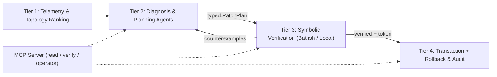

# Neurosymbolic NetOps

Closed-loop network fault diagnosis and remediation prototype combining telemetry anomaly ranking, LLM/rule-based diagnosis, symbolic safety verification (Batfish + local invariants), MCP role separation, and transactional rollback with HMAC-chained audit logs.



## Quick Start

```bash
python -m venv .venv
# Windows: .venv\Scripts\activate | Linux/macOS: source .venv/bin/activate
pip install -r neurosymbolic_netops/requirements.txt

python run_full_system.py demos
python run_full_system.py tests
```

See [neurosymbolic_netops/README.md](neurosymbolic_netops/README.md) for architecture details, Batfish/LLM setup, benchmark results, and [LIMITATIONS.md](neurosymbolic_netops/LIMITATIONS.md).
