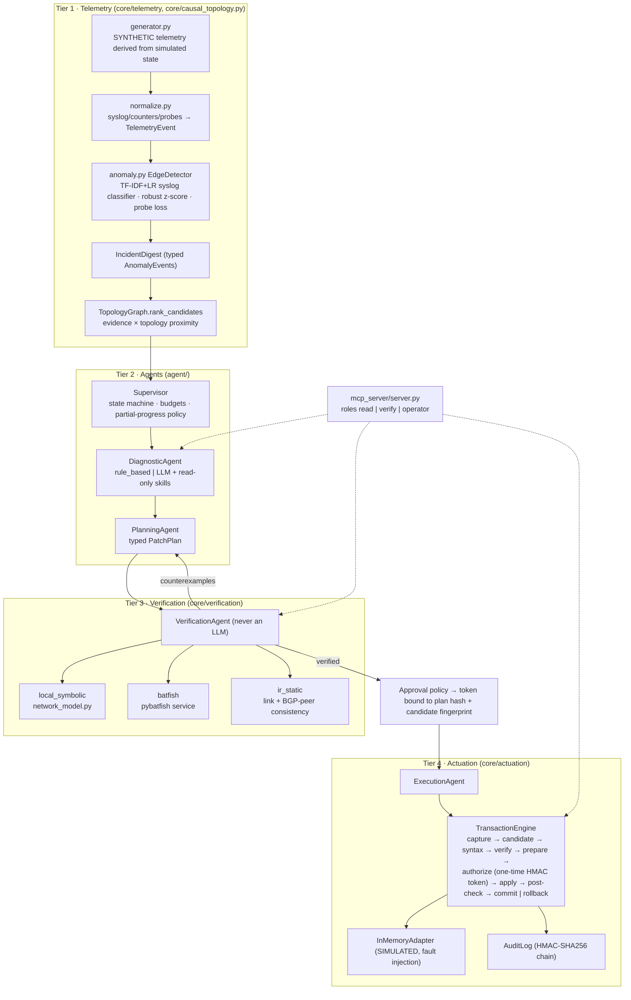
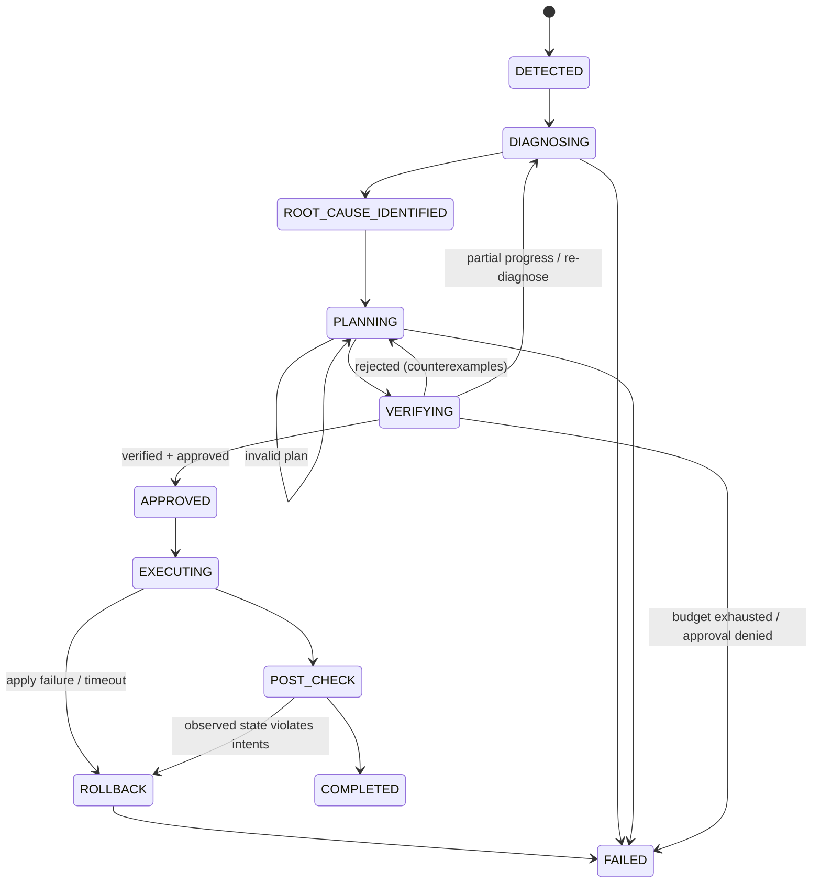

# Architecture

The system is a four-tier closed loop. A vendor-neutral **configuration IR** and **typed patch operations** sit underneath all four tiers. Every result names the component that produced it. Each component carries one of these labels:

- **Reasoning:** `rule_based`, `llm:<provider>/<model>`, or `replay:<provider>/<model>`.
- **Verification:** `local_symbolic`, `ir_static`, or `batfish`.
- **Actuation:** `inmemory/SIMULATED`.

## Incident state machine (`agent/workflow.py`)

Illegal transitions raise `IllegalTransition`. The `IncidentRecord` stores the following:

- every transition;
- the digest and ranked candidates;
- every diagnosis and skill call, each with its evidence ID;
- every plan attempt, with its verification backends, the violations before and after, the new violations, the counterexamples and the disposition;
- the approval token, the transaction steps, the timings and the provider-reported LLM usage.

## Agents and their tool access

| Agent | Input → output | Tools | LLM? |
|---|---|---|---|
| DiagnosticAgent | digest, candidates, feedback → `DiagnosisReport` (hypotheses with evidence IDs) | read-only skills | strategy-dependent |
| PlanningAgent | hypotheses, configs, counterexamples → `PatchPlan` (typed ops only) | read-only skills | strategy-dependent |
| VerificationAgent | network → `VerificationReport` | verifier backends | **never** |
| ExecutionAgent | plan + approval token → `TransactionRecord` | transaction engine (write side) | never |
| Supervisor | orchestrates; owns budgets, the reflection policy, approval and the record | – | never |

## Key data contracts

| Contract | Module |
|---|---|
| `DeviceConfig` / `Network` (IR) | `core/config_ir.py` |
| `PatchOp` (14 kinds), `PatchPlan` (with stable `plan_hash`) | `core/patch_ops.py` |
| Intents (7 kinds) | `core/intent_schema.py`, `configs/intents.yaml` |
| `TelemetryEvent`, `AnomalyEvent`, `IncidentDigest` | `core/telemetry/schema.py` |
| `Hypothesis`, `DiagnosisReport`, `PlanProposal`, `LLMUsage` | `agent/contracts.py` |
| `CheckResult`, `Counterexample`, `VerificationReport` | `core/verification/base.py` |
| `ApprovalToken`, `TransactionRecord`, audit entries | `core/actuation/` |

## Interface name mapping

The IR uses canonical names. `parse_ios` maps vendor names to canonical ones, and the renderers map them back.

| IR | Cisco IOS | Arista EOS | Junos |
|---|---|---|---|
| `ethN` | `GigabitEthernet0/N` | `EthernetN` | `ge-0/0/N` (unit 0) |

The host LANs are routed ports: `eth10` on Leaf-1 and `eth20` on Leaf-2. Batfish deactivates Vlan SVIs that have no member switchports, which broke the original `vlan10`/`vlan20` design.

## Verification backends

| Backend | What it evaluates | Notes |
|---|---|---|
| `local_symbolic` | BGP sessions, reachability (every ECMP branch), redundancy (transit-disjoint paths), isolation, forwarding loops | Deterministic model in `core/network_model.py`, about 12 ms per verification |
| `ir_static` | link consistency (MTU, speed, duplex) and BGP peer consistency (remote AS, MD5 password, address-family activation) | Configuration invariants that Batfish does not model |
| `batfish` | `bgpSessionStatus`, `bgpSessionCompatibility`, `traceroute`, `detectLoops`, `fileParseStatus` | Real service; ~9 s per cold snapshot; snapshots cached by a hash of the rendered config text |

The verifier is always a composite: the forwarding backend (`local_symbolic` or `batfish`) plus `ir_static`. An intent passes only if no backend reports a violation and at least one backend evaluated it. A network with any unparsed configuration line cannot pass.
