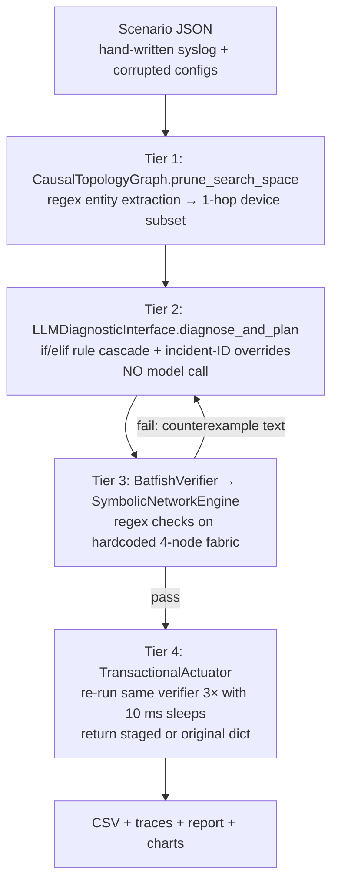

# Implementation Audit

> **Document status (updated after implementation).** Section A is the *current* re-audit of the
> implemented system. Section B, from "Implementation Audit - Neurosymbolic NetOps Framework" onward,
> is the **historical pre-implementation audit** of the original code (git commit `e649acf`). It is
> kept unchanged as the baseline the work was measured against. Its findings describe the old code,
> not the current one.

## A. Re-audit of the current implementation

### A.1 Status of every original finding

| Original finding (Section B) | Current status | Where |
|---|---|---|
| No LLM call; rule cascade mislabelled as LLM | **Resolved.** Gemini, OpenAI and Groq providers with tool calling, validation, retries and provider-reported tokens. Gemini and Groq live-verified. The rule engine is a labelled `rule_based` baseline. | `agent/llm/`, `agent/llm_agents.py` |
| Incident-ID-specific branches | **Resolved.** Removed; a test forbids incident-ID strings in `agent/` and `core/`. | `tests/agents/` |
| Batfish never queried | **Resolved.** Real pybatfish backend, verified against `batfish/allinone`. | `core/verification/batfish_backend.py` |
| Regex verifier with false acceptances; `loop_free = True` | **Resolved.** IR-based local model with computed loops. Both P4 false acceptances are now rejected (tests). | `core/network_model.py`, `tests/unit/test_local_verifier.py` |
| Regex actuator bugs (`no no shutdown`, global ACL unbind) | **Resolved.** Typed, interface-scoped `PatchOp`s (regression tests). | `core/patch_ops.py` |
| Rollback unreachable | **Resolved.** Post-check reads the adapter's observed state; 6 fault-injection tests; 98/98 benchmark rollbacks verified. | `core/actuation/` |
| chars/4 token estimates | **Resolved.** Provider-reported tokens only. | `agent/contracts.py:LLMUsage` |
| Engineered 72% → 100% benchmark | **Resolved.** Withdrawn to `legacy/`; new 151-scenario benchmark with dev/test/legacy splits. | `benchmark/` |
| Vendor translator token check | **Resolved.** IR renderers, with behavioural equivalence checked in Batfish (10/10). | `core/vendor_translator.py` |
| No tests | **Resolved.** 76 default tests plus Batfish- and live-marked suites. | `tests/` |
| No MCP | **Resolved.** Role-scoped MCP server with token-gated writes. | `mcp_server/` |
| No causal discovery | **Partially resolved.** PC algorithm on a synthetic SCM; not used for localisation. | `core/causal_discovery.py` |
| No emulator | **Open.** FRR/Containerlab adapter not implemented. | `LIMITATIONS.md` |

### A.2 Findings from the external review of the improved version, and their resolution

| Finding | Severity | Resolution |
|---|---|---|
| A shared ZIP contained a `.env` with a live Gemini key | Critical | `.env` was never tracked by git. Added `scripts/make_release_zip.py`, which excludes `.env`/`runtime/` and aborts if any API-key pattern is found. **The exposed keys must be rotated by the owner.** |
| Approval tokens fell back to a hardcoded key because `NETOPS_APPROVAL_HMAC_KEY` was undocumented and `.env` was not loaded centrally | Critical | **Fixed.** `core/settings.py` loads `.env` centrally; separate `NETOPS_APPROVAL_HMAC_KEY` and `NETOPS_AUDIT_HMAC_KEY` are documented in `.env.example`; there is no hardcoded fallback (a random per-process key is used and flagged). Test: `test_no_hardcoded_hmac_keys`. |
| Auto-approval was the default supervisor policy | Critical | **Fixed.** `SystemConfig.approval` defaults to `human`, which rejects when no operator is present. `auto_verified_simulation` is an explicit opt-in, refused for any adapter not labelled SIMULATED, and recorded in every incident's `modes`. Test: `test_default_approval_is_human_and_rejects_without_operator`. |
| The audit document described the old code | High | This Section A. |
| LLM benchmark C2–C5 not run | High | Partially addressed: a Groq-hosted **pilot** (see `benchmark/results/REPORT.md`). The full evaluation still needs a paid quota. |
| No real device / emulator adapter | High | Open. |
| Causal discovery not integrated into localisation | High | Open. |
| OpenAI provider not live-validated | Medium | Open (no OpenAI key). Groq uses the same OpenAI-compatible code path and *is* live-verified. |
| The reviewer's environment lacked pinned dependencies | – | Not a code defect. The suite passes in a clean venv built from `requirements.txt` (`python run_full_system.py tests`). |

---

# B. Historical pre-implementation audit

## Implementation Audit - Neurosymbolic NetOps Framework (historical)

**Audit date:** 2026-11-08
**Scope:** Every file under `Agentic_proj/` (≈2,000 lines of Python source, 4 device configs, 2 scenario datasets, stored results, Streamlit dashboard) and the literature review *Autonomous Fault Diagnosis and Closed-Loop Remediation in Telecommunication and Data Center Networks: A Critical Survey* (15 pages).
**Method:** I read all source files line by line and ran read-only probe scripts against the unmodified code (the scripts are outside the repository). **No repository files were changed during the audit.** Every claim below is either a code reference (`file:line`) or comes from a probe execution reported in §9.

---

## 0. Executive summary

The repository is a **coherent and runnable simulation** of the four-tier pipeline described in the survey. It has a sensible module layout, a NetworkX topology graph, Pydantic output models, a regex-based configuration analyser, a reflection loop, and a Streamlit dashboard. The stored 25-scenario results **are reproduced exactly** by the current code (0 mismatches). In that narrow sense they are not fabricated.

However, **the headline claims are not supported by the implementation**:

| Claim in README / BENCHMARK_RESULTS.md | What the code actually does |
|---|---|
| "Live Gemini / OpenAI APIs if configured" | **No LLM is ever called.** `llm_interface.py` contains no HTTP or SDK call. Setting `GEMINI_API_KEY` sets `use_api=True`, and nothing reads that flag. Diagnosis comes from a hand-written rule cascade. |
| "Baseline 72% → Neurosymbolic 100%" | The rule engine **branches on the benchmark incident IDs** (`FAULT_ACL_001`, `FAULT_BGP_003`) to emit a deliberately bad first patch and then a scripted "reflected" fix. If the IDs are renamed, those scenarios pass on turn 1. The remaining baseline failures are the multi-fault scenarios, where the baseline is given only one turn to fix three faults. |
| "Batfish formal safety gate" | Batfish is **never queried**. The live-Batfish branch only opens a session object and then falls through (`batfish_verifier.py:307-318`). All verification is done by a local regex engine with hardcoded topology, subnets, and peer pairs, and with `loop_free = True` hardcoded. |
| "Two-phase commit with watchdog auto-rollback" | The "commit" is a Python dict swap. The post-check re-runs the same deterministic verifier on a snapshot that has already passed, so **rollback cannot happen in neurosymbolic mode**. The "0 rollbacks" figure therefore says nothing about rollback correctness. |
| "Formal semantic equivalence checking" (vendor translator) | It compares token and IP sets. It **accepts a wrong MTU translation** and **rejects its own output** for `no ip access-group`. The Arista "translation" returns its input unchanged. |
| "Causal graph", "anti-manufactured-causality engine" | It is graph neighbourhood selection plus a fixed list of benign syslog prefixes. There is no causal discovery and no time-series data. |
| "37–44% token reduction", "903/160 tokens" | These are character counts divided by 4, measured on prompts that are never sent to any model. |
| "29.9 ms mean latency" | About 20 ms of that is two `time.sleep(0.010)` calls in the watchdog loop. The rest is regex execution. |

**Bottom line:** the architecture skeleton is worth keeping. The "neuro" half (LLM), the "symbolic" verifier backend (Batfish), the actuation substrate, and the benchmark methodology have to be rebuilt to the standard of the prompt's acceptance criteria. Before any number from the current `BENCHMARK_RESULTS.md` is reused, it should be withdrawn.

---

## 1. Repository inventory

```
Agentic_proj/
├── literature_review_agentic (1).pdf      # survey (source of research themes)
├── BENCHMARK_RESULTS.md                   # byte-identical duplicate of the one below
├── run_full_system.py                     # thin launcher → neurosymbolic_netops/run_full_system.py
└── neurosymbolic_netops/                  # the actual project (no git repository)
    ├── agent/llm_interface.py       308   # "LLM" = rule cascade + incident-ID branches
    ├── agent/orchestrator.py        197   # 4-tier pipeline + reflection loop
    ├── core/causal_topology.py      130   # NetworkX graph from JSON + pruning
    ├── core/diagnostic_skills.py    101   # 4 regex "skills"
    ├── core/intent_schema.py         20   # 2 Pydantic models
    ├── core/batfish_verifier.py     335   # regex symbolic engine; Batfish stub
    ├── core/transactional_actuator.py 189 # regex config editor + dict-swap "commit"
    ├── core/vendor_translator.py    132   # regex IOS→Junos; identity IOS→EOS
    ├── dashboard/app.py             390   # Streamlit, 4 views
    ├── dataset/generate_benchmark_dataset.py        # 15 hand-written scenarios
    ├── dataset/generate_advanced_stress_dataset.py  # 10 hand-written scenarios
    ├── dataset/*.json                               # generated scenarios (configs inlined)
    ├── evaluation/run_benchmark.py, generate_report.py, *.csv, *.json, *.png
    ├── configs/base_topology/{Spine-1,Spine-2,Leaf-1,Leaf-2}.cfg  # IOS-like syntax
    ├── configs/testbed_metadata.json                # topology + invariants
    ├── run_full_system.py           111   # master runner (25 scenarios + report)
    ├── requirements.txt, README.md, BENCHMARK_RESULTS.md
```

**Absent:** test suite (no `tests/`, no pytest files), `.env.example`, MCP server, OpenAI SDK dependency, tokenizer, telemetry schema or time-series data, anomaly model, network emulator, audit log, approval mechanism, version control.

**Environment observed:** Windows 11, Python 3.12.4. Installed: `pybatfish 2026.9.17`, `google-genai 2.22.0`, `networkx 3.6.1`, `pydantic 2.13.5`, `pytest 8.3.4`, `streamlit 1.57`, `pandas 3.0`. **Not installed:** `openai`, `tiktoken`, `mcp`, `causal-learn`/`tigramite`. Docker 29.0.1 is installed, but **the Docker daemon was not running** when I checked, so no Batfish container is available. `requirements.txt` lists neither `google-genai` nor `openai`.

---

## 2. Existing architecture (as built)



Control flow lives in `AutonomousNetOpsOrchestrator.process_incident` (`orchestrator.py:29`). One class does all the work. There are no separate agents, no workflow state machine, no approval step, and no audit record beyond the returned trace dict.

---

## 3. Module-by-module findings

### 3.1 `agent/llm_interface.py` — **SIMULATED (rule-based, mislabelled as LLM)**

| Question from brief | Finding |
|---|---|
| Does it invoke an LLM API? | **No.** The module has no `google.genai`, `openai`, or `requests` import. `self.use_api` (`:22`) is set and never read. |
| Are API keys used? | Read from the environment (`:21`) and then ignored. |
| Genuine model reasoning? | No. It is a fixed if/elif cascade: LINK checks (`:45-85`) → BGP checks (`:88-184`) → ACL checks (`:187-233`). The first matching rule wins. |
| Hardcoded incident behaviour? | **Yes.** `:238-261` emits a scripted "naive hallucination" only for `incident_id == "FAULT_ACL_001"` / `"FAULT_BGP_003"`. `:265, :276` force the "reflected" fix using `or incident_id == ...`. |
| Hardcoded topology/policy knowledge | Expected AS numbers are inferred from device-name substrings (`:96`). Leaf-1/Leaf-2 LAN prefixes are hardcoded (`:144-167`). The protected subnet `192.168.99.0` is hardcoded (`:192`), so the "diagnoser" already knows the security invariant. ACL names `BLOCK_BGP_CTRL` and `TRANSIT_FILTER` are matched literally (`:210, :222`). These are exactly the names injected by the dataset generator. |
| Output validation | Pydantic models are used for output. Since no model produces text, there is nothing to validate. |
| Confidence | Constant `0.96` (`:304`). The survey (§4.1) explicitly criticises uncalibrated confidence values of this kind. |
| Unused variables | `start_time`, `logs_str` (`:33-35`). Telemetry logs are never consulted for diagnosis. Only configs are. |
| Interface coverage | Only `eth1`/`eth2` are inspected (`:46`). |

**Assessment:** this is a useful *deterministic baseline* once the ID branches are removed. It is not an LLM component.

### 3.2 `agent/orchestrator.py` — **PARTIALLY IMPLEMENTED**

- **Reflection loop (`:73-147`).** The loop is real: verifier counterexamples are formatted into feedback and passed to the next turn. Because the "agent" is deterministic, the feedback only matters through the two ID-keyed branches and the accumulating `candidate_snapshot`.
- **"Safe partial progress adoption" (`:140-147`).** A patch that *failed* verification is still merged into the working snapshot if it lowers the violation count and does not trigger a security-violation string. Final acceptance is still gated on a full-snapshot pass, but intermediate state is built from unverified patches. This needs to be an explicit, documented policy.
- **Token counting (`:81-99`).** `chars // 4` on a prompt that is never built or sent.
- **Baseline mode (`:107-114`).** One turn, no verification, and the actuator applies only `applied_patches[0]`. Multi-fault baselines fail structurally (one patch, three faults), so this comparison does not isolate the benefit of verification.
- **Localization metric (`:176-177`).** For multi-fault scenarios, a hit on *any* listed culprit counts as correct. This inflates multi-fault accuracy.
- There are no workflow states, no approval gate, and no per-agent separation.

### 3.3 `core/causal_topology.py` — **PARTIALLY IMPLEMENTED (topology); NOT IMPLEMENTED (causal discovery)**

- **Graph construction (`:23-44`).** The graph is built from `testbed_metadata.json`, not parsed from device configs. Every physical link is also labelled `bgp_peering` (`:39`) without checking BGP config.
- **Entity extraction (`:46-73`).** It filters a fixed list of benign log prefixes (`:49`), regex-matches device names and IPs, and hardcodes `10.1.10.* → Leaf-1` and `10.1.20.* → Leaf-2` (`:59-62`).
- **Pruning (`:75-130`).** It returns a device subset. When every device is implicated, it drops one non-seed device (`:106-109`). Much of the "token reduction" comes from this step. The 0.0% reduction in STRESS_MF_003 shows the fallback path.
- **No ranking.** Candidates are returned as an unordered set. Topology does **not** prioritise root-cause candidates. It only filters what the rule cascade sees.
- **No causal discovery.** There is no PC/PCMCI, no time series, and no statistical dependency estimation. Using "causal" in the class name overstates what the module does.

### 3.4 `core/diagnostic_skills.py` — **PARTIALLY IMPLEMENTED**

- There are 4 skills: interface, BGP peer, routing table, ACL audit. All are regex-over-text, return untyped dicts, and have no timeouts, permissions, evidence IDs, or logging.
- `skill_inspect_routing_table` is a substring test (`destination_prefix in config`, `:74`). It does not consult any RIB or perform route lookup.
- `skill_check_bgp_peering` is never called by the diagnoser.
- None of the 17 skills in the brief beyond these four exist (OSPF, ARP, VLAN, traceroute, DNS, syslog analysis, packet loss, latency, …). The survey's SADE reference uses 15 skills.

### 3.5 `core/intent_schema.py` — **PARTIALLY IMPLEMENTED (20 lines)**

- `ConfigurationPatch` carries a **raw CLI string** (`command_block`). That is the opposite of survey §5.2 ("agents must not write raw CLI commands directly").
- There is no declarative intent model (reachability, segmentation, redundancy, and so on). Invariants live in `testbed_metadata.json` and are duplicated as hardcoded literals in the verifier.
- Despite the module docstring, there is no OpenConfig/YANG model or validation.

### 3.6 `core/batfish_verifier.py` — **SIMULATED (local regex engine); Batfish NOT IMPLEMENTED**

- **Live path (`:307-318`).** It imports pybatfish, constructs `Session`, has comments describing queries, and then falls through. No snapshot is initialised and no question is asked. The bare `except: pass` would hide any failure.
- **Liveness check.** A raw TCP probe to `:9997`. In this environment it returned `False`.
- **`SymbolicNetworkEngine` limitations:**
  - Peer pairs, ASNs, and interfaces are **hardcoded** (`:95-100`) rather than derived from configs or metadata.
  - ACL evaluation is **string matching** against literals such as `"192.168.99.0"`, `"10.1.20.0"`, `"eq 179"` (`:71-92`). It does not interpret wildcard masks, prefixes, protocols, or ports. Probe P4 shows a supernet deny `10.1.0.0 0.0.255.255` blocking all LAN traffic is **accepted**.
  - The security invariant only checks that *some* line of an ACL with the specific name `PERIMETER_SECURITY_POLICY` contains `192.168.99.0` and `deny` (`:256-262`). It ignores rule order and interface binding. Probe P4 shows a deny placed **after** `permit ip any any` (so it is never hit) is **accepted**.
  - `loop_free = True` is hardcoded (`:265`).
  - "Reachability" is defined as ≥2 established sessions, both prefixes present, and zero counterexamples (`:269-270`). There is no forwarding analysis, and any unrelated counterexample marks reachability false.
  - Route-map handling only checks whether a `deny` stanza exists for a route-map applied outbound (`:231-236`). It ignores match clauses and sequence order.
  - The BGP check models MTU and duplex mismatch as preventing session establishment, which is not how real BGP behaves on point-to-point links. That is acceptable as a modelling choice only if documented.
- **Positive:** counterexamples are human-readable strings and are actually fed back to the planner. The base configuration verifies clean (probe P2).

### 3.7 `core/transactional_actuator.py` — **SIMULATED**

- **`apply_commands` is a regex text editor, not a CLI interpreter:**
  - `no shutdown` matches the word `shutdown` inside existing `no shutdown` lines and produces **`no no shutdown`** (probe P3: 2 occurrences after fixing Leaf-2 eth2). The verifier does not notice because `^\s*shutdown` no longer matches.
  - `no ip access-group X in` removes **every** `ip access-group` binding on the device, including the security perimeter ACL on both uplinks (probe P3: 0 remaining). The verifier does catch this as a security violation, but it is still a severe interpreter bug.
  - `mtu N`, `speed N`, and `duplex X` rewrite **every** occurrence device-wide, with no interface context.
  - `network …` is inserted after the first line following `router bgp`. ACL `deny/permit` is inserted into the *first* ACL found.
  - Commands it does not recognise are silently ignored, so a syntactically invalid patch looks like a no-op rather than an error.
- **Transaction (`:86-163`).** Steps: (1) call the verifier 3 times on the staged dict, (2) sleep 10 ms between samples, (3) return `COMMIT_CONFIRMED` with the staged dict, or `WATCHDOG_ROLLED_BACK` with the original dict. Nothing is captured, prepared, committed, or restored on any device or emulator. `packet_loss_pct` is a literal `0.0` or `100.0`.
- **Rollback unreachable in neurosymbolic mode.** The post-check is the same pure function on the same input that just passed, so it cannot fail. Rollback can only occur in baseline mode, where verification was skipped.
- There is no authorization step, no audit log, and no fault injection. `rollback_command_block` from the patch is never used.

### 3.8 `core/vendor_translator.py` — **SIMULATED**

- IOS→Junos uses per-line regexes, with a default interface `ge-0/0/0` regardless of the actual interface, a fixed BGP group `underlay`, a fixed filter name `PERIMETER`, and `/24` assumed for every prefix.
- IOS→EOS is the identity function.
- `verify_semantic_equivalence` compares token and IP sets. Probe P8 shows that a Junos MTU of 9000 for an IOS MTU of 1500 is judged **equivalent**, and the translator's own output for `no ip access-group FOO in` is judged **not equivalent**.
- The pipeline does not use this module. Only the dashboard displays it.

### 3.9 Dataset & benchmark — **Results are genuinely produced, but the methodology does not support the claims**

- **Reproducibility.** Re-running all 25 scenarios reproduced every stored value (probe P1). The pipeline is fully deterministic, so repeated trials or confidence intervals are meaningless in the current design.
- **Scenario independence.** Each scenario copies the base configs, so there is no state leakage between scenarios. ✅
- **Train/test contamination.** All 25 scenarios were written alongside the rule engine. Every fault type has exactly one dedicated rule, and the injected ACL names (`BLOCK_BGP_CTRL`, `TRANSIT_FILTER`) are matched literally. The evaluation set is the design set.
- **Telemetry realism.** Telemetry is 2–7 hand-written syslog lines, and most name the culprit device or interface directly. There are no metrics, timestamps, time series, missing-data cases, or misleading-but-plausible alarms. "Noisy" scenarios add only lines from a fixed benign list that the pruning code filters by prefix.
- **The 72% → 100% delta is engineered** (see §0 and probe P6). The 2 single-fault "self-correction" cases come from incident-ID branches. The 5 multi-fault cases fail in baseline because the baseline gets one patch.
- **Latency** is dominated by `time.sleep` (probe P1: 25.7–36.6 ms). It contains no model inference.
- **Token counts** are `chars // 4` of never-sent text.
- **Report generator** (`evaluation/generate_report.py:194, :227, :246, :276`) writes **hardcoded narrative numbers** ("Token Reduction: 50.0%", "Packet loss: 0.0%") into `BENCHMARK_RESULTS.md`, regardless of the data.
- **README vs report inconsistency.** The README says "~44.2% token savings". The report says 37.0%.

### 3.10 Dashboard (`dashboard/app.py`) — **PARTIALLY IMPLEMENTED**

It is a functional 4-view Streamlit app over the orchestrator and the stored CSV. Problems:

- It displays **hardcoded success claims** whenever the regex verifier passes: "Reachability: PASSED (100%)", "DETECT LOOPS = 0", "BGP Sessions: ALL ESTABLISHED" (`:292-295`).
- It labels rejections "REJECTED BY BATFISH" (`:280`) although Batfish never ran.
- It does not distinguish simulated components from real ones anywhere.

### 3.11 Configurations

- The four `.cfg` files use an **IOS-like hybrid**: `interface eth1`, `speed 1000`/`duplex full` on routed ports, `neighbor X activate` without an address-family block, and `route-map NAME deny 10` with no match. Batfish's Cisco IOS parser will likely accept most of this with warnings, but `eth1` naming and the AF-less `activate` lines may produce parse warnings or unrecognised lines. This must be checked against real Batfish before any behavioural claim.
- These configs are not loadable into FRR or any emulator as written.

---

## 4. Feature classification

| Feature | Status | Evidence |
|---|---|---|
| Four-tier module layout | **IMPLEMENTED** (as structure) | `orchestrator.py` |
| Topology graph (NetworkX) | **IMPLEMENTED** | `causal_topology.py:23` |
| Topology-aware pruning | **PARTIALLY IMPLEMENTED** | filtering only, no ranking; hardcoded prefix→device |
| Causal discovery (PC/PCMCI) | **NOT IMPLEMENTED** | — |
| Telemetry normalisation / schema / anomaly detection | **NOT IMPLEMENTED** | syslog strings only |
| Edge SLM / lightweight model | **NOT IMPLEMENTED** | — |
| LLM integration (Gemini/OpenAI) | **NOT IMPLEMENTED** (claimed) | no API call anywhere |
| Rule-based diagnosis | **IMPLEMENTED** (with benchmark-specific overrides) | `llm_interface.py:45-233` |
| Multi-agent separation (Diagnostic/Planning/Verification/Execution/Supervisor) | **NOT IMPLEMENTED** | single orchestrator class |
| Workflow state machine | **NOT IMPLEMENTED** | — |
| Diagnostic skills | **PARTIALLY IMPLEMENTED** | 4 regex skills, untyped |
| Declarative intent model | **NOT IMPLEMENTED** | only patch/diagnosis models |
| OpenConfig/YANG | **NOT IMPLEMENTED** | docstring only |
| Batfish verification | **NOT IMPLEMENTED** (claimed) | stub at `batfish_verifier.py:307` |
| Local symbolic verification | **SIMULATED / PARTIALLY IMPLEMENTED** | regex engine; false acceptances shown |
| Counterexample-driven reflection loop | **PARTIALLY IMPLEMENTED** | loop is real; "revisions" scripted by incident ID |
| Transactional actuation | **SIMULATED** | dict swap |
| Rollback | **SIMULATED; unreachable in main mode** | §3.7 |
| Authorization / approval | **NOT IMPLEMENTED** | — |
| Audit logging | **NOT IMPLEMENTED** | — |
| MCP server | **NOT IMPLEMENTED** | — |
| Vendor translation | **SIMULATED** | regex + identity; broken equivalence check |
| Network emulation testbed | **NOT IMPLEMENTED** | — |
| Benchmark harness | **IMPLEMENTED** (mechanics) / methodology unsound | §3.9 |
| Real tokenizer / provider token counts | **NOT IMPLEMENTED** | chars/4 |
| Test suite | **NOT IMPLEMENTED** | no tests |
| Dashboard | **PARTIALLY IMPLEMENTED** | hardcoded success text |

---

## 5. Research alignment (summary — full matrix will be produced in Phase F)

| Survey theme | Current alignment |
|---|---|
| BiAn (§2.1): SLM digest → specialised agents → topology-ranked culprits; read-only | Topology filtering exists. No SLM, no specialised agents, no ranking. |
| Confucius (§2.1): DAG workflow, emulation sandbox + Batfish pre-flight, human approval on edge routers | Reflection loop exists. No emulation, no Batfish, no approval. |
| MA-RCA / DAGR (§2.1): role separation; typed, side-effect-free dataflow | Not implemented. |
| SADE (§2.2): symptom-routed index over 15 read-only skills | Name used. 4 skills, no symptom routing. |
| NetAssistant (§2.2): LLM for intent/entity extraction only → deterministic workflows | Conceptually close to the existing rule engine. Could be a fair baseline condition. |
| RCAgent (§2.2): iterative tool-use with feedback | Not implemented (no tool-calling model). |
| Cornetto (§2.3): repair as synthesis, accepted iff Batfish shows intent satisfied; multi-fault collapse | The loop is shaped like this. The verifier is not Batfish, and the multi-fault evaluation is not comparable. |
| Intent-LLM (§2.3): declarative intent → programmatic config | Not implemented. Patches are raw CLI. |
| ConfigTrans (§2.3): IR + SMT for functional equivalence | Claimed. Implemented as regex plus token-set comparison. |
| NetLLM / Optical MLLM (§2.4): encoders for time series, uncertainty-triggered escalation | Not implemented. No numeric telemetry exists. |
| Open5GS benchmark (§2.4): token variance, tool-call reliability, timeout recovery | Not measured. |
| §5.1 Causal graph integration | Topology only. No causal discovery. |
| §5.2 Declarative intent + symbolic gate + transactional rollback | All three are simulated. |
| §5.3 MCP with privilege separation and signed audit | Not implemented. |
| §5.4 Two-tier edge/central model deployment | Not implemented. |

---

## 6. Technical limitations (independent of the claims)

1. **Configuration handling is regex-over-text** in four separate places: skills, verifier, actuator, translator. Each has its own regexes and its own bugs. There is no shared parsed model of a device.
2. **Topology facts are duplicated as hardcoded literals** in at least four modules, so changing the topology means editing code.
3. **There is no execution substrate.** Without an emulator or Batfish, "post-deployment checks" cannot observe anything that the pre-deployment check did not.
4. **Everything is deterministic and synchronous**, so latency, retries, timeouts, partial failures, and rate limits cannot occur.
5. **There is no version control.** Phased changes cannot be diffed or reverted.

---

## 7. Implementation priorities (ranked)

1. **Honesty fixes first.** Remove incident-ID branches. Rename the rule engine as the `rule_based` baseline. Stop labelling regex verification as Batfish. Withdraw the stored headline numbers.
2. **A single typed configuration model (IR) plus parser/renderer.** Verifier, actuator, skills, and translator all depend on it. This removes most of the regex bugs at once.
3. **Real Batfish backend**, with the local engine rebuilt on the IR and clearly labelled `local_symbolic`.
4. **Real LLM path** (Gemini, plus OpenAI if wanted) with structured output, tool calling over typed skills, provider token counts, and no silent fallback.
5. **Actuation substrate with real failure modes.** At minimum an in-memory device adapter with fault injection; preferably an FRR emulator adapter. This gives a genuine prepare → approve → apply → post-check → rollback lifecycle.
6. **Agent separation and workflow state machine** with an audit trail.
7. **Benchmark redesign:** parametric scenarios, held-out split, five conditions, safety probes, repeated LLM trials.
8. MCP server, vendor IR translation with Batfish differential checks, edge anomaly model, causal discovery demo, testbed, docs, dashboard.

---

## 8. Risks and dependencies

| Risk / dependency | Impact | Mitigation |
|---|---|---|
| Docker daemon not running; Batfish needs the `batfish/allinone` container (~1.5 GB image, ≥4 GB RAM recommended) | Phase C blocked without it | You start Docker Desktop. Keep `local_symbolic` as a labelled fallback. Batfish integration tests are skipped (not faked) when the service is absent. |
| LLM API keys and cost | LLM conditions cannot run without a key; repeated trials cost money | Budget-capped runs, a cost estimate before each benchmark run, response caching for replay (labelled as replay). |
| Containerlab is not native on Windows (needs WSL2) | Emulation testbed choice | FRR containers via Docker Compose (works on Docker Desktop), or Containerlab inside WSL2. **Your decision, see plan.** |
| Current config dialect is not valid for FRR, and Batfish may emit parse warnings | Behavioural claims depend on correct parsing | Render configs from the IR into proper IOS (for Batfish) and FRR (for the emulator). Fail the build on Batfish parse warnings for base configs. |
| Rule engine and scenarios written by the same author (contamination) | Inflated baseline | Parametric generator with held-out templates/placements. Report dev and test splits separately. State the limitation. |
| LLM nondeterminism | Results vary between runs | n ≥ 3–5 trials per scenario, fixed temperature, report mean ± CI. Store raw responses. |
| Breaking changes to `llm_interface.py`, the dataset format, and stored results | Old scripts and numbers change | Migration notes. Archive old results under `legacy/` with a NOT-REPRODUCIBLE-AS-CLAIMED banner. |
| OneDrive-synced working directory | File-lock or sync conflicts during heavy writes (Batfish snapshots, results) | Write Batfish snapshots to a temp directory outside OneDrive. |

---

## 9. Probe evidence (executed 2026-11-08, unmodified code)

| ID | Probe | Result |
|---|---|---|
| P1 | Re-run all 25 scenarios in both modes; compare with `extended_benchmark_metrics.csv` | **0 mismatches.** Neurosymbolic latency 25.7–36.6 ms. `live_batfish=False`. |
| P2 | Verify unmodified base configs | `passed=True`, no counterexamples |
| P3 | `apply_commands(Leaf-2 with eth2 shutdown, "no shutdown")` | Produces **2× `no no shutdown`**. `no ip access-group …` leaves **0** access-group bindings on Leaf-1. |
| P4a | Base + Leaf-1 `deny ip 10.1.0.0 0.0.255.255 any` (blocks both LANs) | Verifier **passed** (false acceptance) |
| P4b | Base with Leaf-1 security deny moved after `permit ip any any` | Verifier **passed** (false acceptance) |
| P5 | `GEMINI_API_KEY=dummy`; call diagnoser on FAULT_ACL_001 configs with the real ID and with a renamed ID | `use_api=True`, 1.07 ms, no network. Real ID → removes both denies (scripted "hallucination"). Renamed ID → correct single-rule fix on turn 1. Confidence 0.96 in both cases. |
| P6 | Re-run neurosymbolic mode with all incident IDs prefixed `X_` | FAULT_BGP_003 and FAULT_ACL_001 drop from 2 turns to 1. Scenarios needing >1 turn: 7 → 5. |
| P7 | Static analysis of the post-check | The post-check re-runs the deterministic verifier on an already-passed snapshot, so rollback is unreachable in neurosymbolic mode. |
| P8 | Vendor equivalence checker | Junos `mtu 9000` for IOS `mtu 1500` → **equivalent**. Translator's own output for `no ip access-group FOO in` → **not equivalent**. Arista output = input. |
