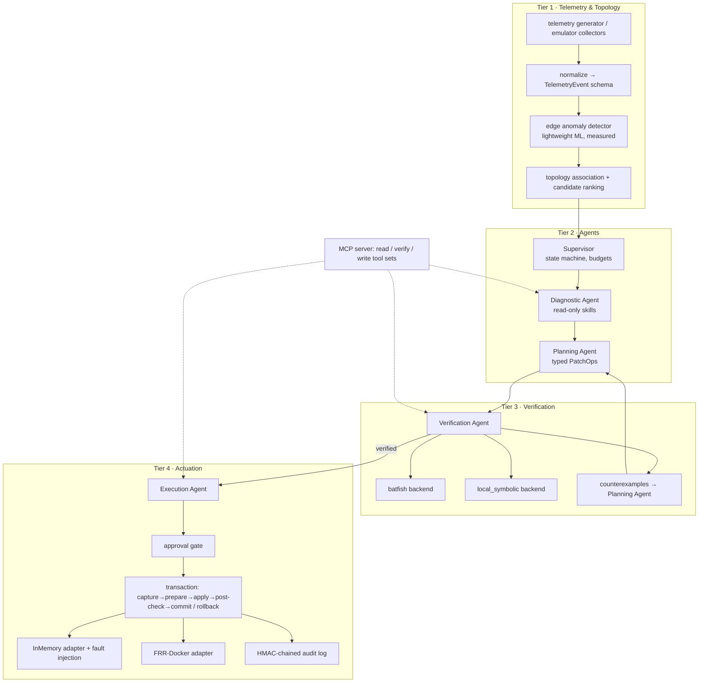

# Implementation Plan — Neurosymbolic NetOps Framework

**Status:** DRAFT. Awaiting approval. No code has been changed.
**Input:** `IMPLEMENTATION_AUDIT.md` (read it first; this plan addresses the findings there by section number).
**Principle:** keep the four-tier layout, the module names, the dashboard, and the topology. Replace the internals that are simulated but labelled as real. Every component gets one of these labels: `IMPLEMENTED`, `PARTIALLY IMPLEMENTED`, `SIMULATED`, `PLANNED`, `NOT IMPLEMENTED`.

---

## 0. Decisions needed from you before Phase B

| # | Decision | Options | My recommendation |
|---|---|---|---|
| D1 | LLM provider(s) and API budget | Gemini only / Gemini + OpenAI / OpenAI only | **Gemini primary** (`google-genai` is already installed), with OpenAI as an optional second provider behind the same interface. I will give a cost estimate before every LLM benchmark run. |
| D2 | Docker usage | Start Docker Desktop and allow pulling `batfish/allinone` (~1.5 GB) and `frrouting/frr` | **Yes.** Without it, "real Batfish" and "emulated deployment" cannot be delivered and stay `PLANNED`. |
| D3 | Emulation testbed | (a) FRR containers via Docker Compose on Docker Desktop · (b) Containerlab inside WSL2 · (c) no emulator, in-memory adapter only | **(a).** It works on Windows without WSL setup and is enough for 4 nodes. (b) is closer to the literature but adds WSL setup. (c) makes the actuator honest but not real. |
| D4 | Version control | `git init` plus a baseline commit of the current state | **Yes.** It makes each phase diffable and revertible. Nothing is pushed anywhere. |
| D5 | Old results | Delete / archive | **Archive** to `legacy/2026-11_pre_audit/` with a banner stating they came from incident-ID-specific code and must not be cited. |
| D6 | Top-level duplicates (`Agentic_proj/BENCHMARK_RESULTS.md`, `Agentic_proj/run_full_system.py`) | Keep / remove | Keep the launcher. Remove the duplicate results file (it moves to `legacy/`). |

---

## 1. Target architecture



**Backbone change (the key design decision).** Introduce one typed **configuration intermediate representation (IR)** and **typed patch operations**. Parsing, verification, actuation, skills, and translation all work on the IR instead of regex over text. This removes the bug classes found in audit §3.6–3.8. It also satisfies survey §5.2, because agents emit structured operations rather than raw CLI. CLI text is *rendered* from the IR for display, for Batfish, and for the emulator.

**Planned layout** (existing files are kept as thin facades so imports don't break):

```
core/
  config_ir.py              # Device, Interface, BgpProcess, BgpNeighbor, Acl, AclRule, RouteMap, StaticRoute
  patch_ops.py              # SetInterfaceEnabled, SetMtu, SetBgpRemoteAs, RemoveAclRule, UnbindAcl, AddBgpNetwork, ...
  parsers/ios.py            # IOS-subset parser → IR (+ explicit "unsupported line" reporting)
  renderers/{ios,frr,junos,eos}.py
  intent_schema.py          # (extended) declarative intents + existing models kept
  telemetry/{schema,normalize,generator,anomaly}.py
  causal_topology.py        # (extended) graph built from IR + metadata; candidate ranking
  causal_discovery.py       # PC algorithm on telemetry time series (clearly labelled)
  skills/                   # typed read-only skill registry (diagnostic_skills.py becomes facade)
  verification/{base,batfish_backend,local_symbolic}.py   # batfish_verifier.py becomes facade
  actuation/{transaction,audit,adapters/{inmemory,frr_docker}}.py  # transactional_actuator.py facade
  vendor_translator.py      # (rewritten) IR-based, Batfish differential validation
agent/
  llm/{base,gemini,openai_provider,replay,tokens}.py      # llm_interface.py becomes facade
  rule_based_diagnoser.py   # the existing cascade, minus incident-ID branches
  agents/{diagnostic,planning,verification,execution,supervisor}.py
  workflow.py               # state machine + IncidentRecord
  orchestrator.py           # (rewritten) delegates to Supervisor
mcp_server/server.py
benchmark/{scenarios/,results/,generator.py,metrics.py,run_benchmark.py}
demos/{demo1_bgp_single_fault,demo2_multifault_reflection,demo3_rollback}.py
testbed/{docker-compose.yml, frr/*}
tests/{unit,llm,verification,agents,transactions,mcp,e2e}/
```

**LLM modes** (no silent fallback; the mode is recorded in every trace):

- `llm`: a live provider call. Fails loudly if the key is missing.
- `rule_based`: the deterministic baseline.
- `offline`: replays recorded LLM responses from a cassette file. Always labelled `replay` in outputs and never reported as a live result.

---

## 2. Phases

Each phase ends with: a summary, a list of changed and created files, the full `pytest` result, the open issues, and a pause for you if a decision is needed.

### Phase A — Audit ✅ (this deliverable)

### Phase A′ — Safety net and honesty fixes (small; first thing after approval)

| Step | Files | Outcome | Validation |
|---|---|---|---|
| A′1 | — | `git init` and baseline commit (D4) | `git log` shows the baseline |
| A′2 | `tests/test_legacy_characterization.py` | Characterisation tests that pin current behaviour, so refactors are deliberate | Tests pass on the unmodified code |
| A′3 | `agent/llm_interface.py` → `agent/rule_based_diagnoser.py` | Remove incident-ID branches (`:238-286`) and the constant 0.96 confidence. Rename to rule-based. | Test: renaming any incident ID never changes the output |
| A′4 | `legacy/`, README banner, dashboard labels | Archive old results. Change "Batfish" to "local symbolic (regex, legacy)" wherever the code isn't Batfish. | grep finds no unqualified "Batfish" in UI strings |
| A′5 | `requirements.txt`, `.env.example`, `pyproject`/`pytest.ini` | Pinned dependencies (google-genai, pybatfish, pytest, …) | `pip install -r` in a fresh venv works; `pytest` runs |

### Phase B — Core architecture

| Step | Files | Outcome | Validation |
|---|---|---|---|
| B1 | `core/config_ir.py`, `core/parsers/ios.py`, `core/renderers/ios.py` | IR plus an IOS-subset parser and renderer. Unsupported lines are reported, never dropped silently. Base configs migrated to valid IOS naming (`GigabitEthernet0/1` or `Ethernet1`) with a documented mapping. | Round-trip tests: parse→render→parse is equal for all base and scenario configs. Unknown-line reporting test. |
| B2 | `core/patch_ops.py`, rewrite of `actuator.apply_commands` | Typed, interface-scoped operations replace regex editing. Invalid operations raise errors instead of being ignored. | Regression tests for the audit P3 bugs (`no no shutdown`, global ACL unbinding, device-wide MTU) |
| B3 | `core/telemetry/*` | `TelemetryEvent` schema (timestamp, device, interface, source ∈ {syslog, counter, bgp_state, probe…}, severity, value). Normaliser for syslog and counters, missing-data flags, dedup, and a scenario-driven **synthetic telemetry generator** (labelled synthetic) that produces time-series counters plus syslog, with noise and dropout. | Unit tests per source; missing-data and duplicate handling tests |
| B4 | `core/telemetry/anomaly.py` | Edge detector: robust z-score/EWMA on counters, plus a small TF-IDF + logistic-regression syslog classifier trained on generated data with a held-out split. Measure size, latency, and precision/recall. Labelled **lightweight ML, not an SLM**. | Test-split metrics written to file. Latency benchmark. |
| B5 | `core/causal_topology.py` | Graph built from IR (BGP edges from the actual neighbor config, not assumed). Hardcoded prefix→device mappings removed. Candidates get **scores** from anomaly evidence and topological centrality/proximity, returned as a ranked list. | Tests on ranking. Pruning recall (culprit retained) measured on the benchmark. |
| B6 | `core/skills/*` | Typed skill registry: interface, interface errors, BGP peer, routing table (computed from IR, not substring), route lookup, ACL inspection (proper wildcard/prefix/port matching), ACL packet test, MTU, link-state, syslog analysis, packet-loss/latency analysis over telemetry. Each skill has a Pydantic input/output schema, evidence IDs, a timeout, a permission tag (`read`), and a log line. OSPF/ARP/VLAN/DNS/traceroute skills are implemented only where the IR or emulator provides data; otherwise they are listed as PLANNED. | One test file per skill, including error and timeout paths |
| B7 | `agent/llm/*`, `.env.example` | `LLMProvider` interface. Gemini provider (structured JSON output into Pydantic models, function calling over skills, timeout, retry with backoff on 429/5xx, provider-reported token usage, redacted request/response log). OpenAI provider if D1 says so. Replay provider. Missing key gives a clear error with no fallback. | Mocked-boundary tests (invalid JSON, schema violations, timeout, 429, 5xx, missing key). **One live smoke test, marked `@pytest.mark.live`**, run only with a key, and reported separately. |
| B8 | `agent/agents/*`, `agent/workflow.py`, `agent/orchestrator.py` | Five agents with distinct contracts. Diagnostic: evidence + skills → ranked hypotheses. Planning: hypothesis + counterexamples → `PatchPlan` of typed operations. Verification: plan → verdict + counterexamples (calls backends, never the LLM). Execution: verified + approved plan → transaction. Supervisor: state machine (DETECTED→…→COMPLETED / ROLLBACK / FAILED), budgets (turns, tokens, wall time), and the `IncidentRecord` trace. | State-transition tests (illegal transitions rejected). Contract tests per agent. Supervisor budget tests. |

**Checkpoint after B:** the rule-based mode runs end to end on the new architecture, and the LLM mode runs if a key is present.

### Phase C — Verification

| Step | Files | Outcome | Validation |
|---|---|---|---|
| C1 | `core/intent_schema.py` | Declarative intents (Reachability, Isolation/Segmentation, BgpSessionUp, NoLoops, Redundancy (≥k disjoint paths), AclMustDeny) as Pydantic models, loaded from `configs/intents.yaml`. Vendor-neutral. **No OpenConfig compliance claim** unless real OpenConfig YANG validation (e.g. via `pyangbind`) is added; that is listed as optional. | Schema validation tests |
| C2 | `core/verification/local_symbolic.py` | Rebuilt on the IR: per-device RIB from BGP (eBGP best-path subset) + connected routes, a forwarding walk for reachability with ACL evaluation at each hop, loop detection by walking FIB paths (no hardcoded `True`), and a counterexample object (flow, path, dropping rule or missing route). Labelled `local_symbolic`, with its modelling limits documented. | Tests including the audit P4 false-acceptance cases, which must now be **rejected** |
| C3 | `core/verification/batfish_backend.py` | Real pybatfish: init snapshot from rendered IOS configs (temp directory outside OneDrive), fail on parse errors, and run `bgpSessionStatus`, `reachability`/`traceroute`, `detectLoops`, `searchFilters`, and `filterLineReachability`. Results are mapped to the same verdict and counterexample types, with the raw Batfish answer frames kept as evidence. | Integration tests marked `@pytest.mark.batfish`, run against a live container and **skipped, not faked,** when it's absent. A differential test compares batfish and local_symbolic verdicts on all scenarios, and disagreements are reported. |
| C4 | `agent/agents/planning.py`, `supervisor.py` | Bounded reflection: counterexamples are passed back to Planning as structured data, up to max N attempts. Attempts, failures, counterexamples, revised plans, time, and tokens are all recorded. "Partial progress adoption" becomes an explicit, configurable policy that is recorded in the trace. | Test with a deliberately unsafe first plan (from a test-only scripted planner, not production code) to show rejection → revision → acceptance |

### Phase D — Safety and execution

| Step | Files | Outcome | Validation |
|---|---|---|---|
| D1 | `core/actuation/transaction.py` | Lifecycle: capture running config → build candidate → syntax check (parse) → intent check → symbolic verification → prepare → **approval token** → apply → post-check (re-collect state from the adapter, not the verifier) → commit or **compensating rollback** to the captured config → verify restore. Documented as **prepare/commit with compensating rollback, not true 2PC**, unless the adapter supports candidate/confirmed-commit. | — |
| D2 | `core/actuation/adapters/inmemory.py` | Simulated device adapter with **fault injection**: apply failure, timeout, post-check failure, partial multi-device failure, rollback failure. Labelled SIMULATED. | The six fault-injection tests from the brief. Every transaction's final state is in the audit log. |
| D3 | `core/actuation/adapters/frr_docker.py`, `testbed/` (if D2/D3 approved) | Real adapter against FRR containers (`vtysh` via `docker exec`). Post-check reads live `show bgp summary`, routes, and a ping/probe. | Integration tests marked `@pytest.mark.emulator` |
| D4 | `core/actuation/audit.py` | Append-only JSONL with an HMAC-SHA256 hash chain. The key comes from the environment. A tamper-detection verifier is included. (This is a real cryptographic integrity mechanism. It is not PKI non-repudiation, and the docs will say so.) | Tamper test |
| D5 | `mcp_server/server.py` | MCP server built with the official `mcp` Python SDK over stdio. Three tool groups: **read** (topology, interfaces, routing, BGP, ACL, telemetry), **verify** (validate intent, verify plan, reachability, ACL analysis), **write** (prepare, apply, rollback). Write tools need a server-side role in config **and** a one-time approval token bound to a verified plan hash. Pydantic input validation, timeouts, redaction, audit. | In-process MCP client tests: discovery, invocation, read-only role denied write, write denied without a valid token, token replay rejected. A demo script runs a real client↔server session. |
| D6 | `core/vendor_translator.py` | IR → IOS / Junos / EOS renderers. **Behavioural validation through Batfish** (which parses all three dialects): the same intents and session states must hold on each rendered snapshot, and `compareFilters` checks ACL equivalence. Unsupported constructs are listed explicitly. Equivalence is claimed only for what passes these checks. | Per-vendor render tests. Batfish differential tests (marked). |

### Phase E — Experimental validation

| Step | Files | Outcome | Validation |
|---|---|---|---|
| E1 | `testbed/` | FRR topology mirroring the 2-spine/2-leaf fabric, with fault-injection scripts for link down, BGP AS/auth/AF faults, ACL faults, route-map, multi-fault, noisy and missing telemetry, and failed deployment | Scripts are idempotent, with a reset between scenarios (survey §4.4 state drift) |
| E2 | `benchmark/generator.py`, `benchmark/scenarios/` | **Parametric** scenarios: fault templates × location × telemetry variant (phrasing, noise level, dropout, culprit not named) × combinations (k=1..3), with a fixed seed. **Dev split** (used while building rules and prompts) and **held-out test split** (unseen placements and combinations, frozen before evaluation). Plus a **safety probe set** of known-unsafe and known-safe patches to measure verifier false accept/reject independently of any planner. | Scenario schema validation. Split leakage check. |
| E3 | `benchmark/run_benchmark.py`, `metrics.py` | Conditions: (1) rule-based · (1b) rule-based + verifier gate · (2) LLM-only (single shot, no tools) · (3) LLM + tools · (4) LLM + tools + verification/reflection · (5) full closed loop with actuation and injected deployment faults. Metrics: top-1/top-k localisation, P/R/F1 over culprit sets, repair success, intent satisfaction, false-accept/reject, rollback success, partial-deployment recovery, latency split (LLM / tools / verification / actuation), provider tokens, tool calls, reflection turns, invalid-response rate. n ≥ 3 trials for LLM conditions, mean ± 95% bootstrap CI. Raw JSONL per run plus an environment manifest (git SHA, model ID, backend, seeds). | Dry run on 3 scenarios. Cost estimate shown before the full run. |
| E4 | `EXPERIMENTAL_METHODOLOGY.md`, `benchmark/results/` | Actual results only, generated from raw files by script. No hand-typed numbers. | The report regenerates byte-identically from raw files |
| E5 | `core/causal_discovery.py` | PC algorithm (`causal-learn`) on the synthetic telemetry time series, evaluated against the generator's known ground-truth dependency graph (SHD, edge precision/recall). Labelled as "causal discovery on synthetic telemetry with known structure". Its contribution to localisation is reported as an ablation only if it helps. | Unit test on a known DAG. Ablation results. |

### Phase F — Documentation, demos, final validation

| Step | Files | Outcome |
|---|---|---|
| F1 | `demos/demo1..3` | Demo 1: BGP single fault end-to-end. Demo 2: multi-fault with a real verification failure → counterexample → revision. Demo 3: verified plan → injected post-check failure → rollback → restored config + audit record. Each demo prints its backend labels (`llm`/`replay`/`rule_based`, `batfish`/`local_symbolic`, `inmemory`/`frr_docker`). |
| F2 | `dashboard/app.py` | Keep the 4 views. Add an incident state timeline, evidence, hypotheses, counterexamples, transaction/rollback state, and audit log. Remove the hardcoded success text. Show backend labels on every result. |
| F3 | Docs | `README.md`, `ARCHITECTURE.md`, `IMPLEMENTATION_STATUS.md`, `EXPERIMENTAL_METHODOLOGY.md`, `LIMITATIONS.md`, `LITERATURE_ALIGNMENT_MATRIX.md` (all 17 rows × 7 columns), `.env.example` |
| F4 | — | Full test run (unit + marked integration) with the report, all three demos executed, and a final implementation report answering the brief's nine questions |

---

## 3. Explicitly out of scope (will be documented as PLANNED / NOT IMPLEMENTED)

- Real production-device integration (NETCONF/gNMI to hardware). There is nothing to test against, so no adapter will be written.
- Open5GS/5G-core testbed, optical MLLM, GNN fault classifiers. These are discussed in the alignment matrix only.
- Fine-tuned SLM at the edge. A lightweight classical model is provided instead, with honest labelling.
- SMT-based translation proof (ConfigTrans). Batfish behavioural differential checking is used instead and described as such.
- PCMCI. The PC algorithm is used. PCMCI would only be added if time-lagged dependencies prove necessary.

## 4. Breaking changes and migration

| Change | Migration |
|---|---|
| `LLMDiagnosticInterface` no longer produces rule-based output silently | Use `mode="rule_based"` explicitly, or provide a key for `mode="llm"` |
| `ConfigurationPatch.command_block` (raw CLI) replaced by typed operations | Old field kept as a rendered, read-only view for one release |
| Scenario JSON format (telemetry events, intents, split field) | `benchmark/migrate_legacy_scenarios.py` converts the 25 old scenarios. They are kept as a "legacy" suite. |
| Base configs renamed to valid IOS interfaces | Mapping table in `ARCHITECTURE.md`; topology metadata updated |
| Stored CSVs, charts, and `BENCHMARK_RESULTS.md` | Moved to `legacy/` and superseded by `benchmark/results/` |

## 5. Global acceptance gates (checked at the end of every phase)

1. `pytest -m "not live and not batfish and not emulator"` passes. Marked suites are reported separately with pass/skip counts.
2. No incident-ID string appears in `agent/` or `core/` (grep check in CI test).
3. Every result record carries its `llm_mode`, `verifier_backend`, and `actuation_adapter` labels.
4. No number appears in a doc unless a script that reads raw result files generated it.
