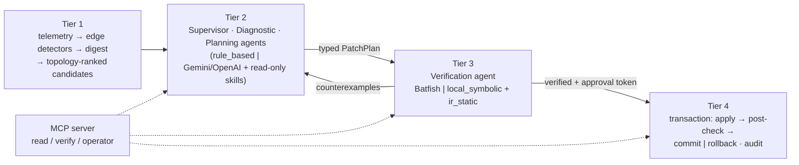

# Neurosymbolic NetOps: Autonomous Fault Diagnosis and Closed-Loop Remediation

A research prototype that implements the closed-loop architecture proposed in *Autonomous Fault Diagnosis and Closed-Loop Remediation in Telecommunication and Data Center Networks: A Critical Survey* (Butt, Siddique, Sultan). It works as follows:

- Language-model or rule-based agents diagnose faults using typed, read-only tools.
- They propose repairs only as **typed configuration operations**, never raw CLI.
- Every repair must pass **symbolic verification against declared intent**: real Batfish, or a labelled local model.
- Changes are deployed through a **transaction with compensating rollback** and an HMAC-chained audit log.

> **Honesty note.** This repository replaced a pre-audit version whose headline results were not produced by an LLM or by Batfish (see `IMPLEMENTATION_AUDIT.md`; the withdrawn results are in `legacy/`). Every result now names the component that produced it. Read `LIMITATIONS.md` before citing anything.

## Research motivation
The survey identifies four obstacles:
1. diagnostic hallucination and uncalibrated confidence;
2. a latency mismatch between LLMs and network recovery;
3. write-side risk without rollback;
4. the gap between testbeds and production networks.

It argues for causal and topology grounding, declarative intent with symbolic safety gates, transactional actuation, MCP-style privilege separation, and tiered models (§5). This project builds each of those mechanisms at testbed scale and measures them.

## Architecture



See `ARCHITECTURE.md` for the state machine, agent contracts, verification backends and data contracts.

## What is real, what is simulated

| Real and working | Simulated / synthetic | Planned / not done |
|---|---|---|
| Gemini API integration (tool calling, structured output, retries, provider-reported tokens). Live-verified. | Telemetry (generated from simulated network state) | FRR / Containerlab emulator adapter |
| Batfish verification (pybatfish against `batfish/allinone`). Live-verified. | Device adapter (`InMemoryAdapter` with fault injection) | NETCONF, gNMI, real devices |
| MCP server with a real MCP client↔server protocol exchange | Causal-discovery data (synthetic SCM) | LLM benchmark conditions C2–C5 (API quota) |
| Typed IR, parser and renderers (IOS, EOS, Junos); translation checked behaviourally in Batfish | | OpenConfig / YANG intents; SLM edge model |

Full table: `IMPLEMENTATION_STATUS.md`. Survey mapping: `LITERATURE_ALIGNMENT_MATRIX.md`.

## Installation (clean environment)

```bash
python -m venv .venv
```
Activate it (`.venv\Scripts\activate` on Windows, `source .venv/bin/activate` elsewhere), then:
```bash
pip install -r requirements.txt
```
```bash
cp .env.example .env
```
Python 3.12 was used, and dependency versions are pinned.

### LLM provider
Edit `.env`:
- Set `NETOPS_LLM_MODE=llm` and `NETOPS_LLM_PROVIDER=gemini` (or `openai`).
- Set `NETOPS_LLM_MODEL`; `gemini-3.6-flash` was used for the live runs.
- Set `GEMINI_API_KEY` (or `OPENAI_API_KEY`).

A missing key raises an error. There is never a silent fallback to the rule-based mode. `NETOPS_LLM_MODE=offline` replays recorded exchanges from `runtime/llm_cassette.json`, and these are labelled `replay`.

### Batfish
```bash
docker run -d --name batfish -p 9996:9996 -p 9997:9997 batfish/allinone
```
Then pass `--verifier batfish` to demos or `--oracle batfish` to the benchmark. If the service is unreachable, the code raises `BatfishUnavailable` rather than substituting the local model.

### MCP server
```bash
python -m mcp_server.server --role read
```
The roles are `read`, `verify` and `operator`, and the server speaks MCP over stdio. Write tools also need an approval token issued out of band.

### Testbed
The testbed is configuration-level only: four IOS configs plus `configs/testbed_metadata.json` and `configs/intents.yaml`. The FRR emulator is planned (see `LIMITATIONS.md`).

## Run

```bash
python run_full_system.py demos
```
```bash
python run_full_system.py demos --reasoning llm
```
```bash
python run_full_system.py tests
```
```bash
python -m pytest -m batfish -o addopts=""
```
```bash
python run_full_system.py benchmark --conditions C1,C1b,C1c
```
```bash
python -m benchmark.report
```
```bash
python run_full_system.py dashboard
```

The first command runs all three demos with rule-based reasoning and the local verifier. The second uses live Gemini. `python -m pytest -m batfish` needs Batfish running; `python run_full_system.py tests` runs the suite without live LLM, Batfish or emulator tests. `python -m benchmark.report` writes `benchmark/results/REPORT.md`, and the dashboard is a Streamlit app.

### Demonstrations
Transcripts are in `demos/output/`.

1. **`demo1_bgp_single_fault`** – BGP remote-AS fault. It shows:
   - anomaly digest and ranked candidates;
   - skill calls and the hypothesis;
   - the typed patch and its verification;
   - the authorised transaction and post-check.
2. **`demo2_multifault_self_correction`** – a wrong ACL on a leaf uplink plus a missing prefix. The first repair is **rejected with an isolation-breach counterexample**, and the revised plan restores the perimeter ACL.
3. **`demo3_failed_deployment_rollback`** – a verified plan whose deployment then fails post-check (injected runtime fault). The system rolls back automatically, verifies the restore, and the audit chain verifies.

## Results
All numbers are in `benchmark/results/REPORT.md`, generated from raw files; the method is in `EXPERIMENTAL_METHODOLOGY.md`. Headline findings:

- **The verification gate removes unsafe deployments.** Rule-based, no gate vs with gate:
  - unsafe deployments fall to zero on both the dev and held-out splits;
  - repair rate goes up on both;
  - the remaining gated failures fail safe, with nothing deployed.
- **Rollback:** every injected apply failure or timeout led to a rollback whose restore was verified.
- **Batfish vs the local model:** they agree on intent violations for 50 of 90 single faults. The 40 disagreements are exactly the fault classes Batfish does not model (L1 mismatches, MD5, address-family activation). This is why the gate composes Batfish with `ir_static` invariants.
- **Batfish disproves a legacy scenario.** `FAULT_ACL_003` is not a fault: a filter on destination port 179 does not stop a session initiated from the other side.
- **LLM evidence is three live demonstration runs only.** They are not a benchmark (see `LIMITATIONS.md` §4).

## Known limitations
`LIMITATIONS.md` lists 17 limitations, including:
- simulated actuation and synthetic telemetry;
- LLM benchmark not run because of the API quota;
- author contamination of the rule baseline;
- Batfish's static scope;
- HMAC rather than PKI signatures.

## Repository map
```
core/        config_ir, parsers/, renderers/, patch_ops, intent_schema, network_model,
             causal_topology, causal_discovery, telemetry/, skills/, verification/, actuation/,
             vendor_translator, inventory (+ facades with the pre-audit module names)
agent/       contracts, workflow, agents, supervisor, rule_based_diagnoser, llm/, llm_agents, orchestrator
mcp_server/  MCP server with role-scoped tools
benchmark/   faults, generator, legacy migration, run_benchmark, differential_verifier, report, scenarios/, results/
demos/       three end-to-end demonstrations + recorded outputs
dashboard/   Streamlit UI
tests/       unit, llm (mocked + live-marked), agents/transactions/e2e, mcp, verification (batfish-marked)
legacy/      withdrawn pre-audit results
```
